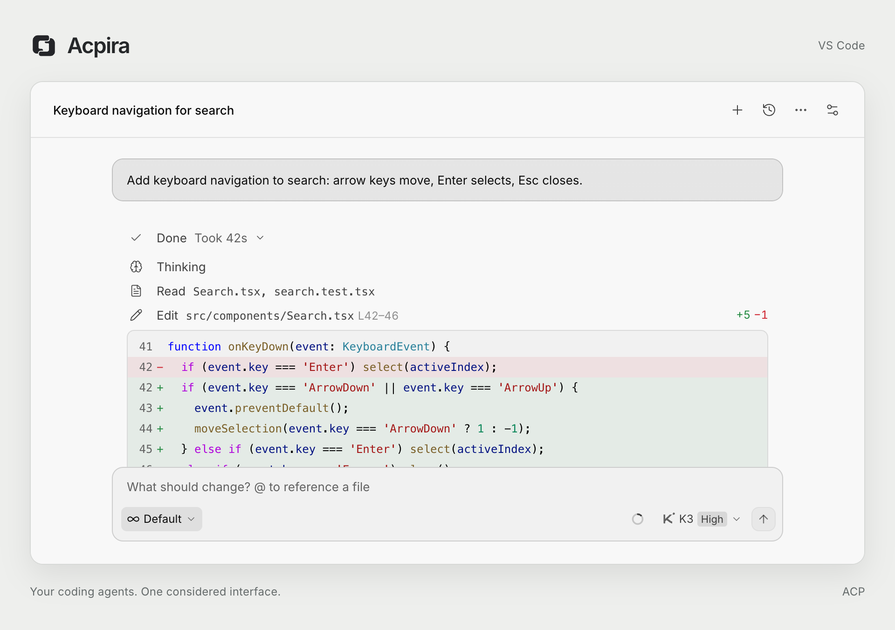
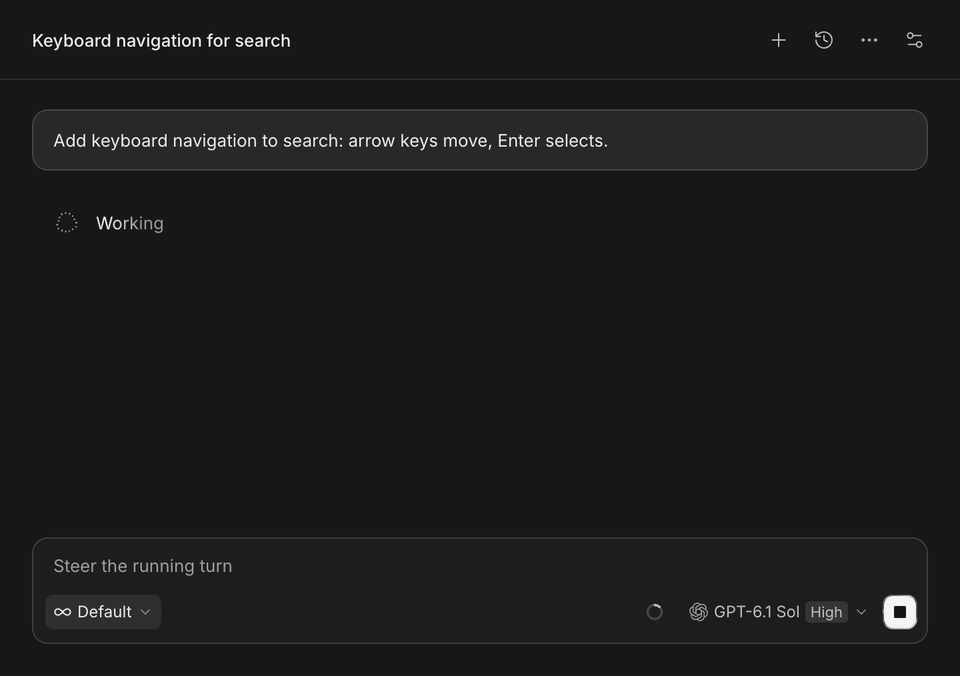
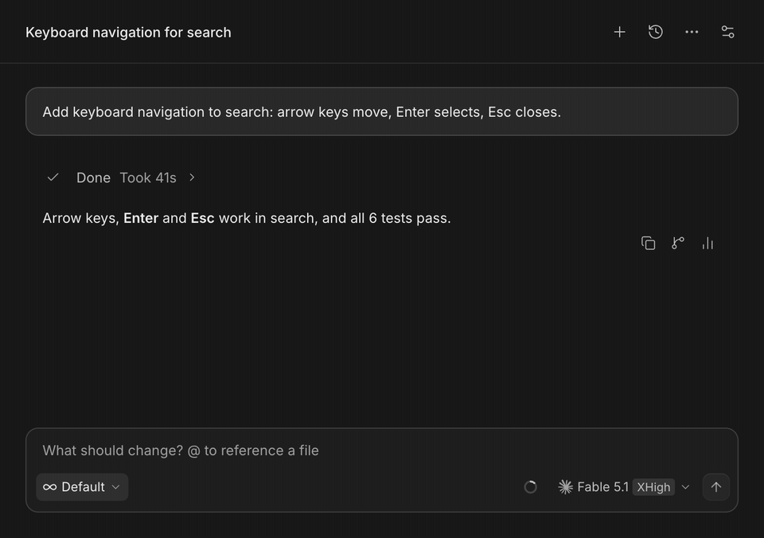
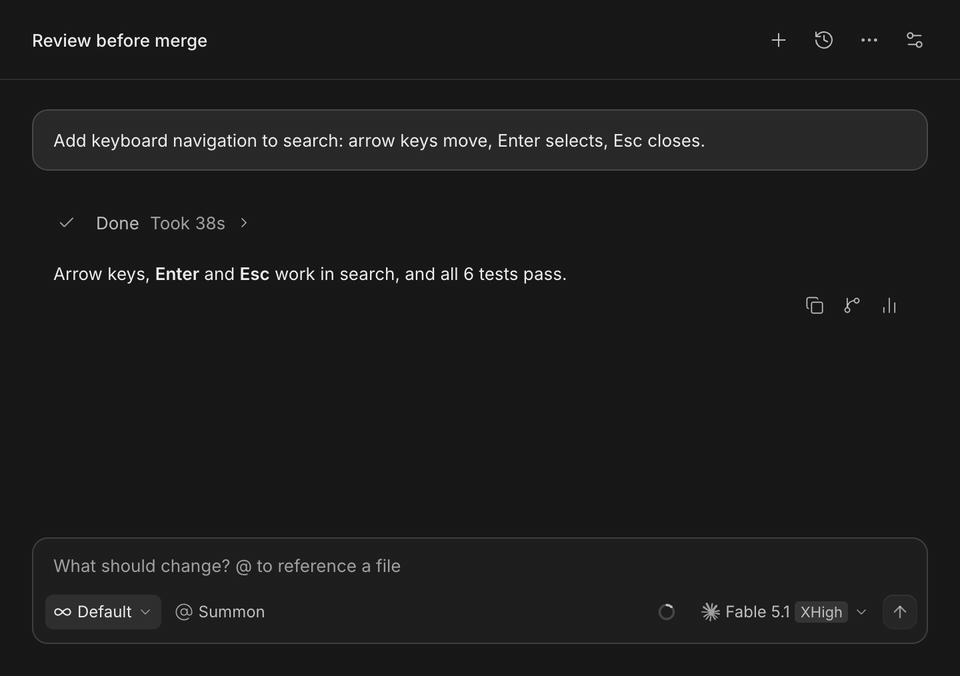
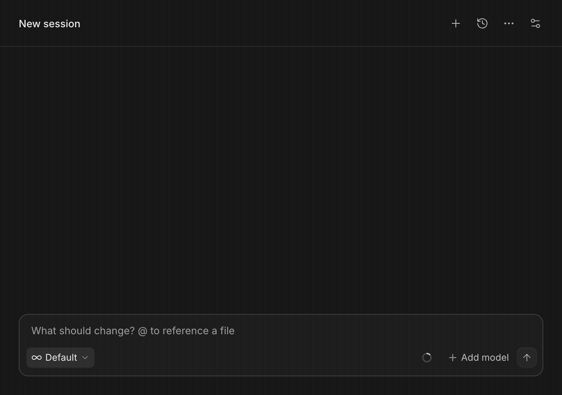

# Acpira

[](https://github.com/hotic/acpira/actions/workflows/windows-compat.yml)
[](https://marketplace.visualstudio.com/items?itemName=hotic.acpira)
[](https://open-vsx.org/extension/hotic/acpira)
[](https://plugins.jetbrains.com/plugin/34192-acpira)
[](LICENSE)

**原生的 Agent Harness，讲究的交互体验。**

在 VS Code、Cursor 与 IntelliJ IDEA 中使用 Grok、Devin、Kimi Code、Codex、Claude、OpenCode、Antigravity、Pi 及其他 ACP Agent。保留各自的执行引擎，也可以通过 Acpira 内置 Agent 直接使用任意模型 API。无论用哪个 Agent，都能清晰查看执行过程、审批操作，在任务进行时继续安排下一步。

[English](README.md) ｜ **简体中文**

<picture>
  <source media="(prefers-color-scheme: dark)" srcset="https://raw.githubusercontent.com/hotic/acpira/main/media/readme/hero-dark.png">
  <source media="(prefers-color-scheme: light)" srcset="https://raw.githubusercontent.com/hotic/acpira/main/media/readme/hero-light.png">
  
</picture>

- **执行记录。** 在对话中查看文件读取、代码修改和命令输出。
- **消息队列、引导与审批。** Agent 工作时可追加排队消息；在 Claude、Codex 和内置 Agent 上还能把消息直接插入正在运行的回合。计划审阅和权限审批在对话中完成。
- **跨 Agent 子代理。** 把其他 Agent CLI 设为子代理，用 `@名称` 召唤；每个子代理都在自己的 CLI 会话中运行，完成后把结果交回对话。
- **切换 Agent，保留熟悉的操作。** 支持 Grok、Devin、Kimi Code、Codex、Claude、OpenCode、DSH、Antigravity、Pi 及其他兼容 ACP 的 CLI，共用会话管理与模型控制界面。
- **内置 Agent，任意模型都能用。** 接入 OpenAI 或 Anthropic 兼容的端点，例如 DeepSeek、GLM、OpenRouter 或本机 Ollama，即可直接用它写代码，无需额外安装。
- **一套配置，全部 Agent 共享。** `~/.agents` 里的 Skills、MCP 服务与指令对每个 Agent 生效。项目的 `.agents/hooks.json` 用同一套规则检查提示词、代码修改和已完成的回合，不论运行的是哪个 Agent。

<table width="100%">
  <tr>
    <th width="50%">执行过程与中途引导</th>
    <th width="50%">添加与切换 Agent</th>
  </tr>
  <tr>
    <td width="50%" valign="top">
      <a href="media/readme/steps.gif">
        
      </a>
    </td>
    <td width="50%" valign="top">
      <a href="media/readme/agents.gif">
        
      </a>
    </td>
  </tr>
  <tr>
    <td valign="top">读取、修改、测试按进度逐条出现。Agent 工作时发出的消息直接加入正在运行的回合，结束后整个过程收成一行，点击即可重新展开。</td>
    <td valign="top">在设置页安装 Agent，再从「+」菜单用它开始新会话。</td>
  </tr>
  <tr>
    <th width="50%">跨 Agent 子代理</th>
    <th width="50%">内置 Agent</th>
  </tr>
  <tr>
    <td width="50%" valign="top">
      <a href="media/readme/summon.gif">
        
      </a>
    </td>
    <td width="50%" valign="top">
      <a href="media/readme/builtin.gif">
        
      </a>
    </td>
  </tr>
  <tr>
    <td valign="top">用 <code>@名称</code> 召唤运行在其他 Agent CLI 中的子代理，完成后各自把结果交回对话。</td>
    <td valign="top">接入 OpenAI 或 Anthropic 兼容的端点并填入密钥，从它的模型列表中挑选加入，回到对话即可选用。</td>
  </tr>
</table>

*使用示例对话录制，画面来自 Acpira 实际界面。引导需在「设置 → 常规 → 排队消息改为引导」中开启。点击图片查看大图。*

## 为什么保留原生 Agent

Harness 会影响模型在实际任务中能发挥到什么程度。它负责驱动 agentic loop：调用模型、执行工具、回传结果，再组织上下文继续下一步。同一个模型，这套循环的实现不同，任务通过率、成本与速度都可能发生变化。

Acpira 通过 ACP 连接 Agent CLI，把模型调用与执行留在所选 Agent 中。Kimi Code 运行 `kimi acp`，Devin 运行 `devin acp`，Grok 运行 `grok agent stdio`。工具与上下文压缩继续由各自的 CLI 负责。

Acpira 负责这套执行流程周围的界面：代码差异、可展开的执行细节、待办、审批和排队消息。切换 Agent 后，这些操作保持一致。

有些模型没有自己的 Harness。为此 Acpira 自带一个运行在引擎内部的内置 Agent，覆盖读文件、改代码、执行命令、联网搜索和制定计划这些日常循环。模型只提供 API 时选它；厂商有官方 CLI 时，优先用官方 CLI。

<details>
<summary>相关评测</summary>

以下评测从不同任务出发，比较模型与 Harness 的组合。各项分数的定义不同，适合在同一评测内对照。

| 评测 | 范围 | 结果或方法 |
| --- | --- | --- |
| [Artificial Analysis Coding Agent Index](https://artificialanalysis.ai/agents/coding-agents) | 独立评测；覆盖 DeepSWE、Terminal-Bench 2.1 和 SWE-Atlas-QnA | 包含固定 **Claude Opus 4.7、比较不同 Harness** 的视图，同时报告成本、Token 和耗时；每题运行三次。 |
| [FrontierHarness Eval v1.0](https://frontierharness.org/) | Kimi K3；30 道软件工程任务；9 个 Harness、12 种配置 | 通过率介于 **50.0%–66.7%**。[公开数据与方法](https://github.com/frontier-harness-eval/eval)。 |
| [Composio 八种 Harness 对比](https://composio.dev/content/best-ai-agent-harnesses) | 通过 OpenRouter 使用 Kimi K3；25 道业务应用任务；共用 MCP 工具 | 通过率介于 **68%–88%**。在共有用量数据的 24 道任务上，估算 API 总成本介于 **$9.28–$35.37**。 |
| [PawBench v1.0](https://github.com/agentscope-ai/PawBench) | AgentScope/OpenJudge 团队评测；9 个模型 × 3 个 Harness × 150 道任务 | 固定 Qwen3.6-35B-A3B，综合分数介于 **56.7–68.3**。采用自动检查与模型裁判，参评对象包含该团队的 QwenPaw。 |
| [Harness-Bench](https://arxiv.org/html/2605.27922v1) | 研究预印本；106 道离线任务；8 个模型后端 × 6 个可配置 Harness | 在相同模型池上取平均，综合分数介于 **52.4–76.2**。分数含完成情况与过程质量，衡量完整配置差异。 |

来源、指标与更多对比见[评测说明](docs/harness-evaluations.md)。

</details>

## 工作原理

Acpira 位于活动栏，通过 [ACP](https://agentclientprotocol.com)（JSON-RPC over stdio）驱动官方 Agent CLI：

- `grok agent stdio`
- `devin acp`
- `kimi acp`
- `codex-acp`
- `claude-agent-acp`
- `opencode acp`
- `dsh --profile acp`
- `pi-acp`
- Google Antigravity 的 ACP 服务（由 Acpira 下载）
- `acpira agent`，即由 Acpira 引擎自身提供的内置 Agent
- 任何兼容 ACP 的命令（在 Agent 所在机器的 `~/.acpira/agents.json` 中添加，可从 Acpira 设置 → 常规 → Agent 启动配置打开）

界面、会话、权限审批、账号与上下文预算由 Acpira 管理；使用 CLI Agent 时，模型调用、Agent 执行与上下文压缩仍由该 CLI 完成。Acpira 的引擎是随各平台安装包附带的原生小程序，VS Code、Cursor 与 IntelliJ IDEA 共用同一套实现；Acpira 本身不需要 Node.js。

支持为每个 Agent 保存多个账号、粘贴或拖入图片，以及通过 `@` 附加工作区文件。对话可在侧栏或编辑器标签页中打开。

Agent 启动配置保存在 Agent 所在机器上。远程工作区读取远程的 `~/.acpira/agents.json`，不继承客户端 IDE 的 Agent 配置。文件按 Agent ID 保存定义，例如：

```json
{
  "opencode-custom": {
    "name": "OpenCode (custom)",
    "command": "opencode",
    "args": ["acp"]
  }
}
```

可选字段包括 `env`、`login`、`install`、`requires`、`subagents` 和 `terminalAuth`。使用内置 Agent ID 会替换该 Agent 的完整定义；保存后对新会话生效，清空为 `{}` 则恢复内置定义。本地旧 `acpira.agents` 仅在文件不存在时迁移一次；远程已有自定义定义可手动复制到远程文件中。

## 安装

1. 从 [Visual Studio Marketplace](https://marketplace.visualstudio.com/items?itemName=hotic.acpira)（VS Code）或 [Open VSX](https://open-vsx.org/extension/hotic/acpira)（Cursor 及其他基于 VS Code 的编辑器）安装 **Acpira**。每个 [GitHub Release](https://github.com/hotic/acpira/releases) 也附有 macOS、Linux、Alpine、Windows（x64 与 arm64）的单平台 `.vsix`，可用 **从 VSIX 安装…** 安装。IntelliJ IDEA 2026.1 及以上可从 JetBrains Marketplace 安装插件，或从 `acpira-<version>-universal.zip` 安装（**Settings → Plugins → ⚙ → Install Plugin from Disk…**）；通用包内置各支持平台的原生后端，无需 Node.js，并支持客户端与后端操作系统不同的远程开发。GitHub 上另有体积更小的单平台包。
2. 选择要用的 Agent。内置 Agent 不需要 CLI，只要一个模型端点和它的密钥，详见 [内置 Agent](#内置-agent)。要使用厂商的 Agent，请安装对应 CLI，并保证它在 `PATH` 上：
   - [Grok](https://x.ai) — `grok`（`grok agent stdio`）
   - [Devin](https://devin.ai) — `devin`（`devin acp`）
   - [Kimi Code](https://www.kimi.com) — `kimi`（`kimi acp`）
   - [Codex](https://developers.openai.com/codex) — `codex-acp`（`npm install -g @agentclientprotocol/codex-acp`）
   - [Claude](https://code.claude.com) — `claude-agent-acp`（`npm install -g @agentclientprotocol/claude-agent-acp`）
   - [OpenCode](https://opencode.ai) — `opencode`（`opencode acp`）
   - [DSH](https://deepseekdocs.com/en/docs/guides/acp-automation-server) — `dsh`（`npm install -g @deepseek-ai/dsh`）
   - [Pi](https://github.com/svkozak/pi-acp) — `pi` 与 `pi-acp`（`npm install -g @earendil-works/pi-coding-agent pi-acp`）
   - [Antigravity](https://antigravity.google/docs/ide/extensions) — 在它的设置页安装，下载的原生包会经过校验和核对。它使用独立的 Google 登录，与 `agy` CLI 的登录互不相通。

   未安装 CLI 的 Agent 在菜单中显示为灰色；它的设置页可在后台直接安装并实时显示日志，也给出官方安装命令，可复制或在终端中运行。新装好的 CLI 会被自动识别，无需重新加载窗口。网络需要代理时，在常规设置中设置「网络代理」，Agent 及其模型请求、登录和安装都会走这个代理。
3. 点击**活动栏**（左侧）的 Acpira 图标。若未显示，在活动栏空白处右键勾选 **Acpira**。也可把视图拖到副侧栏。IntelliJ IDEA 中打开右侧的 **Acpira** 工具窗，标题栏按钮可把对话开成编辑器标签。

## 开始使用

1. 安装 Agent CLI 并登录，或为内置 Agent 添加模型来源。在 Agent 菜单中添加或切换账号，详见 [账号](#账号)。
2. 从活动栏打开 Acpira，或运行 **Acpira: 打开聊天**。
3. 在输入框下方的工具栏中选择 Agent、模式与模型，然后发送消息。回合进行中发送的后续消息会进入队列。点击方形按钮可取消当前回合。

### 内置 Agent

**Acpira** Agent 排在 Agent 列表第一位，可对接任何 OpenAI Chat Completions、OpenAI Responses 或 Anthropic Messages 端点。

- **模型来源。** 在它的设置页填入端点的 Base URL 与密钥即可添加。Acpira 会检查连接、拉取模型列表，并用一次小请求测试模型。本机运行的 Ollama 与 LM Studio 可一键添加。密钥保存在 Acpira 的密钥文件中。
- **工具。** 能读写和修改文件、执行命令与后台任务、搜索工作区、维护待办，还能抓取网页和联网搜索。联网搜索默认免费，也可填入自己的 Jina 密钥。
- **计划模式与权限。** 计划模式只写计划，写完交给常规的计划审批卡片。修改文件和执行命令默认先询问，可在「权限」一节改为自动编辑或完全放行。
- **上下文。** 会读取 `AGENTS.md`，`~/.agents` 与项目 `.agents` 中的 Skills 可作为斜杠命令使用。长会话会自动压缩，也可以手动发送 `/compact`。
- **其他。** 支持高速档的模型会出现 Fast 开关。在「快速任务」中选一个小模型，可以为新会话自动起标题。

已在 GPT、Claude、Gemini、GLM、MiniMax 与 DeepSeek 的端点上实测。其他端点理论上可用，但尚未验证。

### 图片与文件

- 支持粘贴或拖入 PNG、JPEG、GIF、WebP 图片（最大 10 MB），图片会随消息发送。
- 从资源管理器拖入文件，或输入 `@` 搜索工作区文件，由 Agent 自行读取。从资源管理器拖入的图片文件会作为图片发送。
- 从系统文件管理器拖入的文本文件（最大 256 KB）会嵌入消息。不支持二进制文件。

### 会话与历史

- 会话、账号和密钥保存在 `~/.acpira`（可用 `ACPIRA_HOME` 覆盖）。VS Code、Cursor 与 IntelliJ IDEA 共用该目录，同时打开也不会互相覆盖。
- 重启后，若 Agent 支持恢复，Acpira 会继续该会话；否则历史记录以只读方式保留。
- 历史列表中的「导入」会列出该 Agent 在当前项目下的原生会话，选中一项即可带着回放的历史导入 Acpira（需要 Agent 支持列出与加载会话）。
- 可以编辑或重试之前的消息，从已完成的回复分叉出新会话，或把对话导出为 Markdown / JSON。
- Devin、Kimi Code、Claude 启动的子代理拥有独立的记录、审批与检查面板，不会混进主对话。
- 上下文用量较高时，Acpira 可自动发送 `/compact`，也可以在上下文面板中手动压缩。压缩与服务端重试会以行的形式出现在对话中。
- Codex 与 Claude 会话可以设定目标。鼠标悬停在某条提示词上，点击其下方的目标图标即可设定。之后目标栏会显示该目标，并可继续或清除。

### 账号

Acpira 可为 Devin、Codex、Claude 保存多份登录，并在创建会话时注入凭据。每个会话绑定一个账号，选择另一账号会创建新会话。Grok 与 Kimi Code 会显示本机 CLI 登录的额度。

- Agent 菜单的下半部分列出已保存的账号，选择一项即可用该账号创建新会话。「导入 CLI 登录」读取该 CLI 本机已有的登录（Devin 为 `~/.local/share/devin/credentials.toml`）。「在终端登录」在隔离目录中运行该 Agent 的登录命令，不影响本机已有登录。远程服务器上同样可用：复制链接并粘贴验证码。
- 密钥写在 `secrets.json`（权限 600），不是系统钥匙串。`accounts.json` 仅保存邮箱、套餐等元信息。会话记录只存储账号 id。
- 每个会话自始至终绑定一个账号。登录提示上的「仅本次」选项（例如 Devin 的「浏览器登录」）只认证当前进程，不会保存。
- 「自动切换账号」（通用设置，默认关闭）会在绑定账号于任务中途耗尽额度时换用另一个已保存账号，并继续同一个 Agent 会话。下一个账号可按最早重置、剩余额度最多或列表顺序挑选。

尚未提供账号列表的 Agent，仍使用各自 CLI 的登录。

### 共享配置与 Hooks

- **共享 Skills、MCP 与提示词。** 在 `~/.agents` 以及项目的 `.agents/skills`、`.mcp.json`、`AGENTS.md` 中维护一套，Acpira 会按各 Agent 的格式链接过去。设置中的「共享」页可新建和删除 Skills、管理 MCP 服务、编辑共享提示词，还能让所有 Agent 统一使用共享内容，支持撤销。
- **MCP 注入。** 共享的 MCP 服务通过 ACP 传给每个会话，不改动任何 CLI 的配置。
- **工作区 Hooks。** 项目的 `.agents/hooks.json` 可以补充上下文、在发送前检查提示词、在审批卡片出现前检查代码修改，并在每个回合结束后复查。它对所有 Agent 一视同仁。Hook 脚本的应答方式与 Claude Code hooks 相同，现有脚本可以直接复用。
- **子代理。** 在设置的「子代理」页定义跨 Agent 子代理，指定它使用的 CLI、模型、推理强度与模式。

### 设置

每个 Agent 有独立的设置页：安装与登录状态、适配器版本、模型显隐，以及该 Agent 从自身配置中加载的 MCP 服务、Skills、规则与配置文件（只读查看）。在设置导航中可以拖动排序或停用 Agent。外观页可调整主题、字号、密度与动效。

常规设置中还有通知、网络代理与 CPU 上限。会话需要处理，或在你没盯着时完成，通知可以播放提示音或弹出系统通知，两者默认关闭。CPU 上限仅在 Windows 上生效，会让 Agent 以低优先级运行。

## 路线图

- 更多 Agent 接入：通过 ACP 或适配器支持 Cursor CLI 等。
- 统一模型配置入口，自动同步到不同 Agent；内置 Agent 的模型来源是第一步。
- 从 Git 仓库、URL 安装 Skills 到共享集合。
- 在共享提示词之上为单个 Agent 追加专属指令。
- 长期方向：独立桌面端。

具体方向见[路线图](docs/roadmap.md#简体中文)。

## 开发

```sh
pnpm install
pnpm build          # VS Code 外壳（esbuild）+ webview（Vite）
pnpm probe grok     # 直接对 CLI 跑 initialize + session/new
pnpm probe devin --import-local "Reply pong"   # 走账号层：导入本机登录 → authenticate → 一轮
pnpm typecheck && pnpm test
pnpm package        # 打本机平台的 .vsix（含 Rust sidecar）
(cd rust && cargo test --workspace)                  # 引擎
cd apps/intellij && ./gradlew test buildPlugin verifyPlugin   # IntelliJ 插件；buildMarketplacePlugin 打通用 ZIP；buildPluginVariants 打单平台 ZIP
```

按 F5 启动 Extension Development Host。日志在 Output → Acpira。架构与协议说明见 [AGENTS.md](AGENTS.md)。

发布正式版 GitHub Release 后，可自动将各平台 VSIX 发布到 VS Code Marketplace 和 Open VSX，并把 IntelliJ 插件发布到 JetBrains Marketplace。首次凭据配置、版本发布和失败重试见 [发布说明](docs/releasing.md)。

## 许可证

[MIT](LICENSE)
